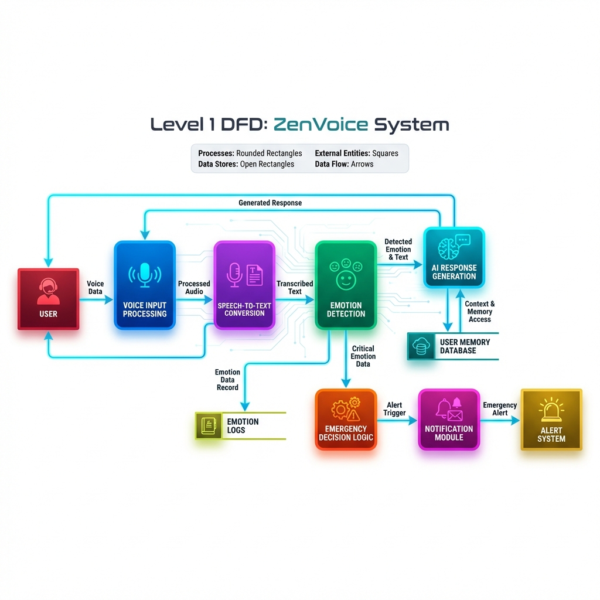

# ZenVoice

ZenVoice lets a caller have a supportive conversation in Hindi or English using an ordinary phone. Twilio handles the call, a Flask application keeps track of the conversation, and an optional Firestore database remembers returning callers. A separate SOS workflow can notify the caller's saved contacts.

Built as a final-year Artificial Intelligence and Data Science engineering project at New Horizon Institute of Technology and Management, Thane. [Read the published research paper (PDF)](https://ijnrd.org/papers/IJNRD2605333.pdf).

## Follow a call

1. Twilio sends the incoming call to `/voice`. ZenVoice greets a returning caller by name or asks a new caller what to call them.
2. Twilio transcribes the reply and posts it to `/process_speech`. The application tracks language, conversation state and emotion cues in the transcript.
3. The dialogue logic handles onboarding and contact setup. For open-ended conversation, it builds a response using the configured language model and returns TwiML so Twilio can speak the reply.
4. The dashboard receives events through a server-sent event stream. The SOS flow can place voice calls to saved contacts and optionally send WhatsApp alerts.



## Run a local demo

Use Python 3.13 and run these commands from the repository root. The example uses Windows PowerShell.

```powershell
python -m venv .venv
.\.venv\Scripts\python -m pip install -r requirements.txt
Copy-Item .env.example .env
```

For a local dashboard walkthrough, set `OPENAI_API_KEY=offline-demo` in the local `.env`. For live AI replies, supply a valid provider key. Twilio calls require your account SID, auth token and voice-enabled phone number. Firestore persistence is optional. Set `FIREBASE_CREDENTIALS_PATH` to a service-account file outside the repository to enable it.

```powershell
.\.venv\Scripts\python app.py
```

Open [the local dashboard](http://127.0.0.1:5000/dashboard). To inspect the first turn offline, run this in a second PowerShell window. The response contains the spoken greeting and the Twilio Gather action.

```powershell
(Invoke-WebRequest -UseBasicParsing -Method Post -Uri http://127.0.0.1:5000/voice -Body @{From='+12025550101'; CallSid='CAoffline'}).Content
```

## Voice integration and privacy

The incoming Twilio voice webhook expects an HTTPS POST to `/voice`. Set `PUBLIC_URL` to the HTTPS origin used for callbacks. Live voice, model responses and outbound notifications require the corresponding provider accounts.

The dashboard, caller-profile and SOS routes in this prototype lack access controls. Twilio callbacks also lack signature verification. Keep the demo on loopback with fictional caller data. A public service needs authenticated operator routes, verified provider callbacks, and controls for consent, log retention and contact notifications. ZenVoice is an academic prototype. Its emotion labels and alerts have no established clinical or emergency-service reliability.

## Speech emotion experiment

The acoustic classifier is a separate experiment. It resamples WAV audio to 22,050 Hz, averages MFCC, chroma and mel-spectrogram features, then trains a scikit-learn multilayer perceptron. The standard phone webhook uses transcript-based emotion cues.

Place RAVDESS speech recordings under `data/raw/<emotion>/`, using the labels `neutral`, `calm`, `happy`, `sad`, `angry`, `fearful`, `disgust` and `surprised`. Run:

```powershell
.\.venv\Scripts\python train_model.py
```

Training writes `models/emotion_model.pkl`. For a pipeline check without recordings, use `train_model.py --demo`. It generates synthetic audio and writes to the same model path. The published study reports **78.2%** eight-class emotion accuracy and **88%** language-detection accuracy. These are results from the authors' evaluation. The training script uses a random sample-level split, so its score does not measure generalization to unseen speakers.

## Source guide

| File | Role |
| --- | --- |
| `app.py` | Call handling, conversation state, contact alerts and dashboard event stream |
| `config.py`, `.env.example` | Provider settings and local configuration template |
| `emotion_detection.py` | Transcript rules and audio-model inference |
| `utils/audio_features.py`, `train_model.py` | Feature extraction, dataset loading and classifier training |
| `realtime_bridge.py` | WebSocket bridge for the experimental realtime audio path |
| `dashboard.html`, `admin.html`, `sos_demo.html` | Operator views and browser-based SOS demo |

## Publication

Piyush Vinod Tawde, Bhavana Satam, Tejas Patharwat, and Monal Malge (2026). **ZenVoice: An Emotion-Aware Bilingual Voice AI System for Mental Health Support and Emergency Response.** *International Journal of Novel Research and Development*, 11(5), d260–d266. Article IJNRD2605333. [Publisher record](https://www.ijnrd.org/viewpaperforall.php?paper=IJNRD2605333)
